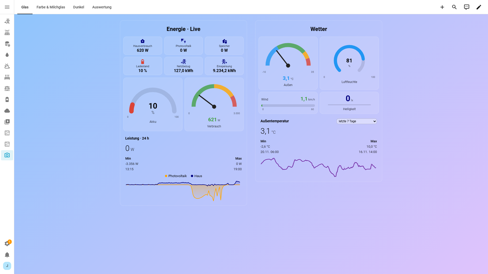
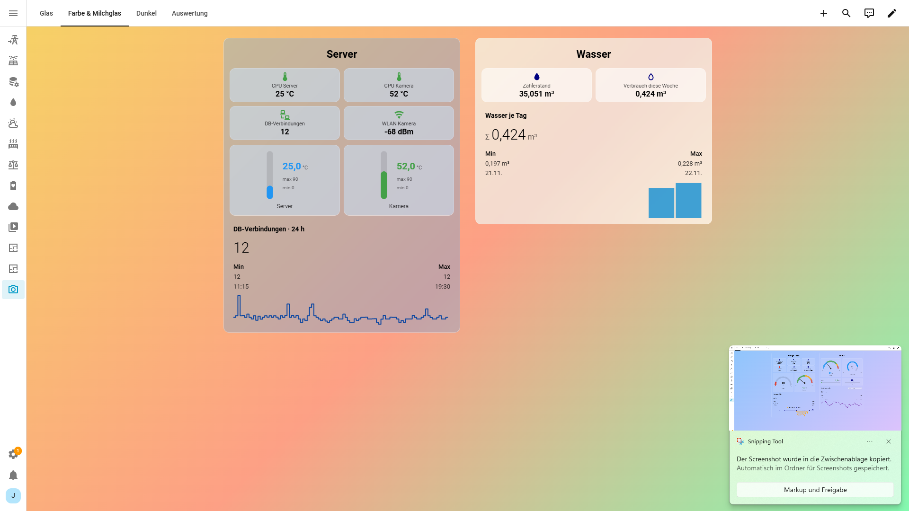
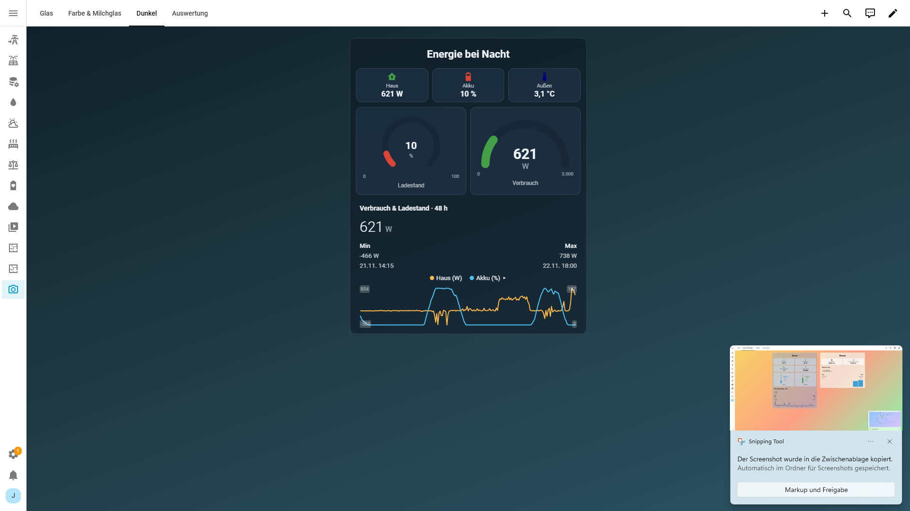
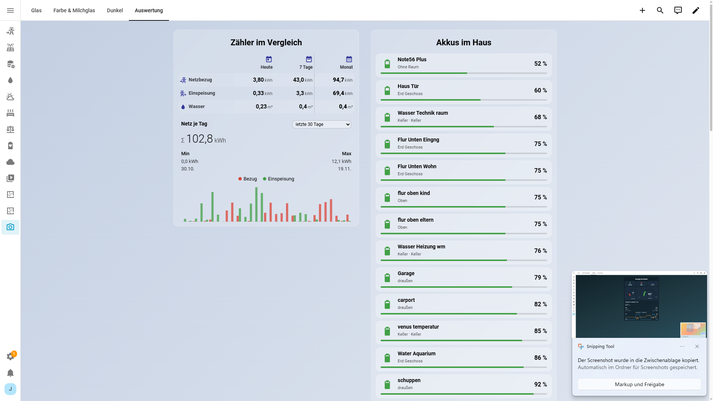
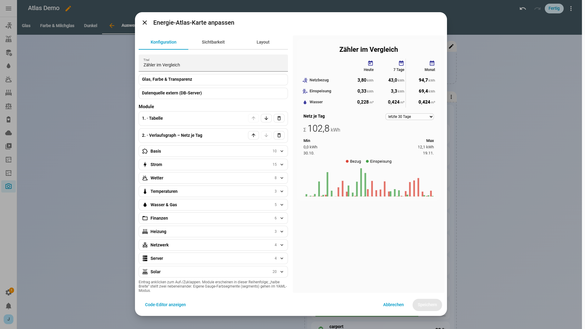

# Energie-Atlas

Eine Baukasten-Card für Home Assistant: **ein** Rahmen, darin frei kombinierbare Module – von Kacheln, Gauges, Graph und Tabelle bis zu rund 65 fertigen Themen-Modulen für Energie, Solar, Heizung, Wetter und mehr. Standardmäßig im Glas-Design, über Farbe, Deckkraft und Milchglas aber an jedes Dashboard anpassbar. Alles lässt sich im visuellen Editor einstellen, YAML ist optional.

*A modular glass-style dashboard card for Home Assistant (UI in German).*



## Funktionen

- **Kacheln** – Wert, Zustand, Attribut, Laufzeit, „vor …“, Zählerverbrauch über einen Zeitraum; Icon-Ampel mit eigenen Schwellen
- **Gauges** – Halbkreis, Ring, Tacho mit Zeiger, Balken waagerecht/senkrecht, große Zahl; eigene Farbsegmente; optional Mittel-/Min-/Maxwert über einen Zeitraum
- **Verlaufsgraph** – Linie, Fläche, Stufen, Balken, gestapelt, Punkte, Min/Max-Band; zweite Y-Achse; Zeitraum-Auswahl direkt auf der Karte (letzte X Stunden/Tage, Woche, Monat, Jahr, fester Monat); Zähler als Verbrauch je Tag
- **Tabelle** – Zeilen × Spalten, Spalten wahlweise als Verbrauch je Zeitraum (heute / 7 Tage / Monat …), Ampelpunkte
- **Batterien** – alle Akkus (`device_class: battery`) automatisch, gefiltert nach Bereich, sortiert nach Ladestand
- **Aussehen** – Deckkraft von Karte, Kacheln und Rahmen, Unschärfe, Milchglas-Effekt, Hintergrund- und Kachelfarbe, Textfarbe für dunkle Designs
- **Ehrliche Daten** – Lücken bleiben sichtbar und werden nicht weginterpoliert

| Farbe & Milchglas | Dunkel |
|---|---|
|  |  |



## Installation

**Marketplace (HACS):** Einstellungen → Marketplace → *Add from link* → Link dieses Repos, Kategorie *Dashboard* → installieren → Browser neu laden.

**Manuell:** `energie-atlas.js` nach `/config/www/` kopieren und unter Einstellungen → Dashboards → Ressourcen als *JavaScript-Modul* mit der URL `/local/energie-atlas.js` eintragen.

## Beispiel

```yaml
type: custom:energie-atlas
title: Energie
modules:
  - type: tiles
    columns: 3
    tiles:
      - name: Hausverbrauch
        icon: mdi:home-lightning-bolt
        entity: sensor.hausverbrauch
      - name: Ladestand
        icon: mdi:battery-70
        entity: sensor.akku_soc
        color: down        # niedriger = schlechter
        warn: 30
        bad: 15
  - type: gauges
    columns: 2
    style: arc
    gauges:
      - entity: sensor.akku_soc
        name: Akku
        min: 0
        max: 100
        segments:
          - { from: 0,  color: "#db4437" }
          - { from: 20, color: "#ffa600" }
          - { from: 50, color: "#43a047" }
  - type: graph
    name: Leistung · 24 h
    hours: 24
    style: area
    series:
      - entity: sensor.pv_leistung
        name: PV
        color: "#ffa600"
      - entity: sensor.hausverbrauch
        name: Haus
```

Aussehen anpassen (alles optional):

```yaml
hintergrund_farbe: "#0b1622"
glas_deckkraft: 55
kachel_farbe: "#1f3347"
kachel_deckkraft: 70
textfarbe: "#eef3f8"
milch: 0
```



## Themen-Module

Neben den Basis-Modulen bringt die Datei rund 65 fertige Themen-Module mit. Im Editor stehen sie in Gruppen unter „Modul hinzufügen“; alle Entitäten sind leer vorbelegt und werden dort ausgewählt.

| Gruppe | Beispiele |
|---|---|
| Strom & Energie | Energiefluss, Tages-/Wochen-/Monats-kWh, Jahresübersicht, Vertrag & Abschlag |
| Solar & Speicher | PV-Übersicht, Wechselrichter-Vergleich, Strings, Speicher (u. a. Sigenergy, Marstek Venus/B2500) |
| Wasser & Gas | Zählerstände, Hochrechnung, Quartale, Ablesung eintragen |
| Heizung & Klima | Heizkurve, Haus-Querschnitt mit allen Räumen, Lüftungsempfehlung |
| Wetter | Aktuell, Wind, Luftdruck-Tendenz, Regen, Helligkeit, Gezeiten |
| Server & Netzwerk | Internet, Netzwerk-Topologie, Switch-Ports, Router/Mesh, Backup-Laufwerke |
| Aquarium, Finanzen | Temperatur/Heizung/Pumpe; Rechnungen & Fälligkeiten (Speicher: eine To-do-Liste) |
| Allrounder | Sankey-Fluss, Fluss-Raster, Fläche gestapelt, Baum/Verteilung, Heiz-/Kühlkreis, Kacheln mit Gauges |

Manche Themen-Module sind auf bestimmte Integrationen zugeschnitten (z. B. Sigenergy, Marstek, FRITZ!, Ecowitt, BSH-Gezeiten) und zeigen ohne passende Entitäten nur „–“.

## Hinweise

- Die **Tempo-Punkte**-Gauge (`dot-gauge-card`) ist im Paket enthalten.
- Die **externe Datenquelle** (Graph-Linien mit `quelle: extern`) ist optional und nur nötig, wenn Verlaufsdaten aus einer eigenen Datenbank über einen Dienst kommen sollen. Ohne Eintrag nutzt die Card immer die Home-Assistant-Historie.
- Erweiterbar: eigene Modul-Pakete können sich über `window.energieAtlas.modules` registrieren.

## Herkunft

Erstellt mit Claude (Anthropic) im Rahmen eines privaten Home-Assistant-Projekts. Ohne Gewähr, ohne Support – Fehlermeldungen und Ideen gern als Issue.

## Lizenz

MIT
